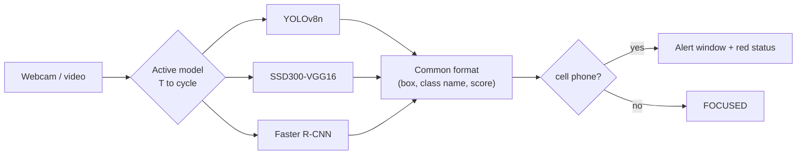

# FocusGuard CV Benchmark


A webcam attention monitor that raises an alert when it sees a phone, built to compare three object
detection architectures on the same task. Press one key to swap between YOLOv8n, SSD300-VGG16 and
Faster R-CNN ResNet50-FPN v2 and see how each trades speed for accuracy. A headless benchmark mode
times all three on identical frames.

## The three architectures

| | YOLOv8n | SSD300-VGG16 | Faster R-CNN R50-FPN v2 |
|---|---|---|---|
| Stages | One | One | Two |
| Box prediction | Anchor-free | Anchor-based (default boxes) | Anchor-based RPN, then per-region refinement |
| Backbone | CSP-style with C2f blocks | VGG16 | ResNet50 + Feature Pyramid Network |
| Input size | 640 px, letterboxed | Fixed 300×300 | Shorter side resized to 800 px |
| Parameters | 3.2 M | 35.6 M | 43.7 M |
| COCO box mAP (published) | 37.3 | 25.1 | 46.7 |

**YOLOv8n: one stage, anchor-free.** A single pass predicts, for each cell of three feature maps,
the distances from that cell to the four box edges plus class scores. There are no predefined box
shapes to match against, and the classification and box-regression heads are decoupled. It is the
smallest and fastest of the three by a wide margin.

**SSD300: one stage, anchor-based.** Also a single pass, but each location on six feature maps of
decreasing resolution carries a fixed set of default boxes with different aspect ratios, 8,732 in
total. The network predicts class scores and offsets for every one. The fixed 300×300 input and the
shallow early feature maps make it weak on small objects, and a phone in a webcam frame is often a
small object.

**Faster R-CNN: two stages.** A Region Proposal Network first scans FPN feature maps with anchors
and proposes about a thousand regions likely to contain something. Each proposal is then cropped
from the feature map with RoIAlign and passed to a second head that classifies it and refines the
box. The second look gives the best accuracy and the highest cost.

## Architecture of this project



All three models sit behind one `Detectors.detect()` method that returns
`(box, class name, score)` tuples, so the drawing and phone-check code does not know which model
ran. Classes are matched by name, which hides the fact that Ultralytics uses 80 COCO class indices
and torchvision uses 91. Models are loaded on first use, so startup only pays for YOLOv8n.

In live mode the two heavier models run on every 5th (SSD) or 10th (Faster R-CNN) frame and their
boxes are reused in between, which keeps the preview responsive. The on-screen number is the true
time per inference. Benchmark mode runs every model on every frame.

## Installation

```bash
git clone https://github.com/10yukine/focusguard-cv-benchmark.git
cd focusguard-cv-benchmark
python -m venv .venv
.venv\Scripts\activate        # macOS/Linux: source .venv/bin/activate
pip install -r requirements.txt
```

For GPU inference, install the CUDA build of PyTorch from <https://pytorch.org/get-started/locally/>
before the last step. Model weights (about 310 MB in total) download automatically the first time
each model is used.

## Usage

### Live monitor

```bash
python focusguard.py
```

| Key | Action |
|---|---|
| `t` | Cycle YOLOv8n → SSD300 → Faster R-CNN |
| `q` | Quit |

| Option | Meaning |
|---|---|
| `--source 0` | Webcam index, or a path to a video file |
| `--video clip.mp4` | Clip to play in the alert window while a phone is visible. Not included; without it the alert is on-screen text only |

### Benchmark

```bash
python focusguard.py --benchmark 50
python focusguard.py --benchmark 50 --source recording.mp4
```

Captures 50 frames, runs all three models on the same frames after a warm-up pass, and prints a
Markdown table of mean latency, FPS and detections per frame. Use a video file as the source for
repeatable numbers.

## Results

Sample run on CPU only, 10 frames of a 640×864 street scene:

| Model | Mean latency (ms) | FPS | Avg detections/frame |
|---|---|---|---|
| YOLOv8n | 111.8 | 8.9 | 4.0 |
| SSD300-VGG16 | 860.9 | 1.2 | 4.0 |
| Faster R-CNN R50-FPN v2 | 6019.3 | 0.2 | 5.9 |

The ordering matches the architectures: the anchor-free single-stage model is fastest, the
two-stage model is slowest and finds the most objects. Absolute numbers depend heavily on hardware,
and a GPU narrows the gap considerably, so run `--benchmark` on your own machine.

## Acknowledgements

Built together with **Gwen Alyzza M. Peregrino**.

## License

MIT
